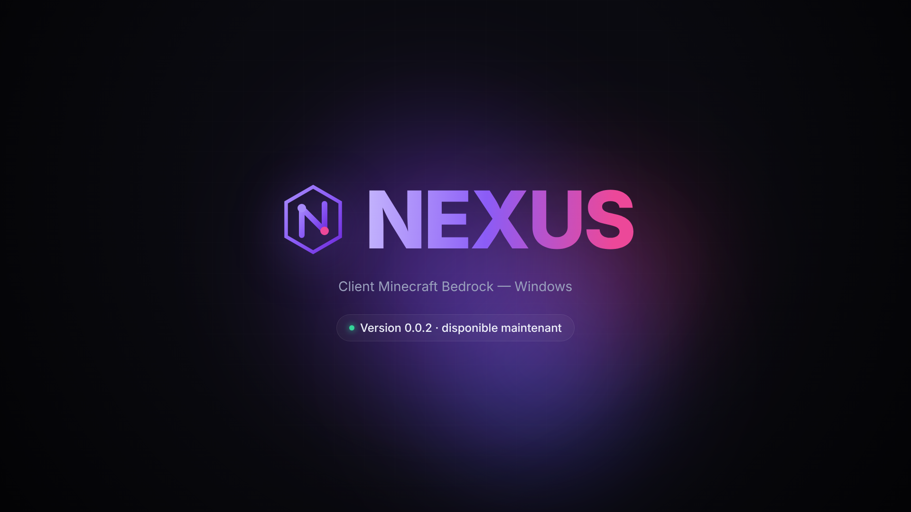
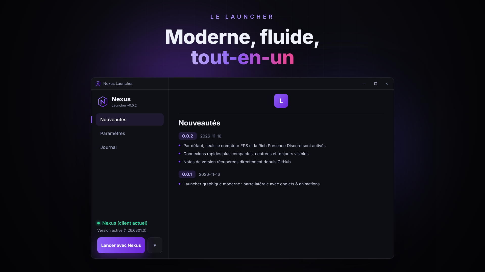
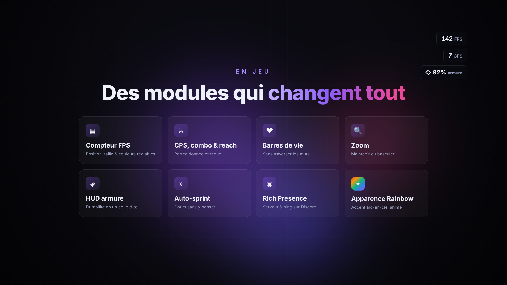
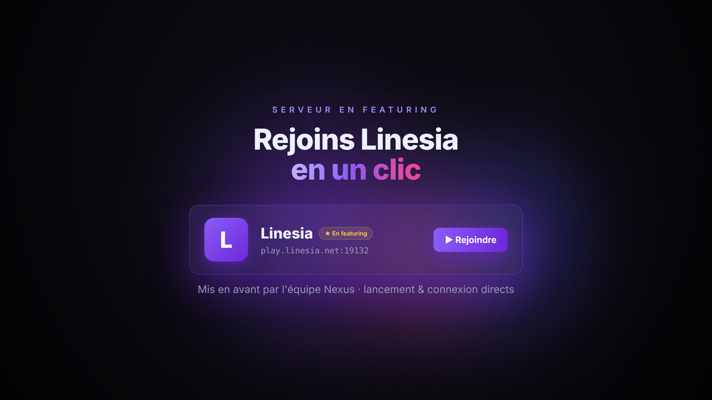

# Nexus

**Client Minecraft Bedrock pour Windows — léger, rapide et en français.**

---

Nexus est un client pour Minecraft Bedrock (Windows) composé d'un **launcher moderne** et de **modules en jeu** (HUD, FPS, zoom, barres de vie…). Il télécharge et installe la version de Minecraft voulue, puis injecte le client sur les versions prises en charge.

## Le launcher

- Barre latérale avec onglets **Nouveautés**, **Paramètres** et **Journal**
- Choix de la version de Minecraft, avec **installation automatique** au besoin
- Notes de version récupérées directement depuis GitHub (toujours à jour)
- Animations fluides, interface entièrement en français

## En jeu

Compteur FPS, CPS / combo / reach, barres de vie, zoom, HUD armure, auto-sprint, Rich Presence Discord, apparence **Rainbow**… Les modules s'activent à la demande depuis le menu (touche **Inser**).

## Connexions rapides

Un serveur mis en avant par l'équipe : un clic lance Minecraft et t'y connecte directement.

## Crédits

- Conçu et développé par **Claude (Anthropic)** — https://claude.ai
- Signatures : **Latite**
- Liste des versions & paquets : **OnixClient** — https://github.com/OnixClient/onix_compatible_appx
- Maintenu par **Zoumi** — https://github.com/ZoumiSurGithub

Nexus n'est pas affilié à Mojang ni à Microsoft.

